Computer Engineering student at VIT Pune (2025 – 2029) who builds, experiments and ships.
I got into this because I was curious how ideas turn into real products, and somewhere between writing code, solving problems and understanding people I got obsessed with making things that are actually useful.
Not just software that works: software that feels considered.
Right now: backend AI at FlyRank, client projects as Technical Lead of the AWS Student Builder Group, and side quests that scratch my own itch.

| | |
| --- | --- |
| **Class** | Software Developer · AI × Full-Stack |
| **Guild** | B.E. Computer Engineering, Vishwakarma Institute of Technology (VIT), Pune · 2025 – 2029 |
| **Grade** | First Class with Distinction |
| **Current quests** | Backend AI Intern @ FlyRank AI · Technical Lead, AWS Student Builder Group VIT Pune |
| **Core CS** | Data Structures & Algorithms · OOP · DBMS |
| **Home world** | Pune, Maharashtra, India |

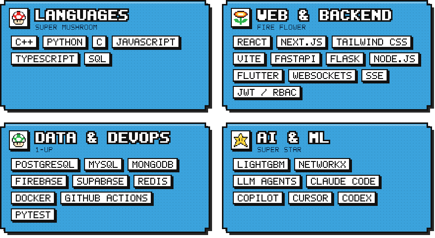

  
  

 

  






<b>LEVEL 1-1 — SUTRA</b> · Financial-crime & insider-risk intelligence platform · <i>hackmatrix</i> · <a href="https://github.com/rokadepiyush49-rgb/HackMatrix-Hackathon">repo</a>

`Python` `FastAPI` `Next.js` `PostgreSQL` `LightGBM` `NetworkX` `Docker`

- Fraud-detection pipeline that links insider access privileges to suspicious payments across 400K+ transactions and 150K access events, using 10 rule-based checks, 5 graph detectors and 3 ML models.
- Explainability layer that argues for and against every alert and simulates which controls would have stopped it.
- 1.00 precision, 0.97 recall and zero false alerts on legitimate look-alikes (synthetic test set).

<b>LEVEL 1-2 — JanMaang</b> · AI-powered civic problem-solving platform · <i>civic tech</i> · <a href="https://github.com/rokadepiyush49-rgb/JaanMaang">repo</a>

`Next.js` `TypeScript` `Flutter` `FastAPI` `PostgreSQL` `PostGIS` `Redis` `LLMs`

- Multilingual, voice-enabled, offline-first mobile app with geotagged submissions and before-and-after evidence verification.
- Identical reports are clustered so forty people asking for the same fix count as one demand with the weight of forty.
- Multi-agent system where AI agents debate student-proposed solutions and check legality, authenticity and feasibility before recommending one.

<b>LEVEL 1-3 — BoardroomAI</b> · An AI board of directors for startup founders · <i>live demo</i> · <a href="https://github.com/rokadepiyush49-rgb/BoardroomAI">BoardroomAI</a> · <a href="https://rokadepiyush49-rgb.github.io/BoardroomAI/">play live</a>

`Next.js 16` `TypeScript` `Groq` `Supabase`

- Built for HackAgentAIx, the international hackathon hosted by the University of Essex.
- Every pitch goes in front of a full executive board instead of a single AI opinion; each executive argues from its own lens before the board votes.
- The debate is turned into actionable startup intelligence: a decision and an execution plan.

<b>LEVEL 1-4 — Transparent Charity</b> · Milestone-verified donation escrow on Ethereum · <i>web3</i> · <a href="https://github.com/rokadepiyush49-rgb/transparent-charity-blockchain">repo</a>

`Solidity` `Express` `PostgreSQL` `React` `Vite` `Tailwind CSS`

- Evidence is part of the protocol: each file's SHA-256 and EXIF are anchored on-chain.
- Six deterministic checks per submission catch re-used, resized, edited, back-dated or far-away photos.
- A public /verify page re-hashes a photo in the browser, and anyone can stake ETH to freeze a suspicious payout.

<b>BONUS STAGE — More worlds</b> · Smart Farmer AI · Lumiora · <i>bonus</i> · <a href="https://github.com/rokadepiyush49-rgb/Smart-Farmer-AI">Smart Farmer AI</a> · <a href="https://github.com/rokadepiyush49-rgb/Lumiora">Lumiora</a>

`React` `Vite` `Tailwind CSS` `TypeScript` `TinyML`

- **Smart Farmer AI**: crop disease detection from a photo, profit-ranked crop recommendations, weather advisories and a direct farmer-to-factory marketplace.
- **Lumiora**: multimodal intraoperative surgical margin assessment using hyperspectral imaging and TinyML.


> The world map above is **not** GitHub's built-in graph, which can't be restyled or animated from a
> README. It's a custom SVG rendered from the real calendar by
> [`scripts/sync-contributions.mjs`](scripts/sync-contributions.mjs), and a
> [scheduled workflow](.github/workflows/sync-world.yml) refreshes it every day.


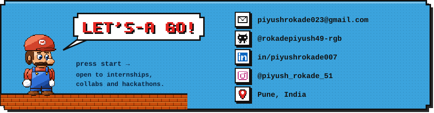

  
  
  
  


<!--
  ─────────────────────────────────────────────────────────────────────────
  This README is generated, along with every image in it.

    npm run assets   re-render README.md + readme/*.svg from data/profile.mjs
    npm run sync     pull real contribution data, then re-render

  Edit words in data/profile.mjs, not here. See HOW-IT-WORKS.md.
  ─────────────────────────────────────────────────────────────────────────
-->
